<div align="center">


# FOMC Tone Lab

**Reading the Fed the way a rates desk does.** A hawkish-dovish index from every Fed statement, set of minutes, press conference and Board speech since 2009, scored by Claude with evidence you can check, tested on Treasury yields across the curve and traded as a duration tilt. Every test uses only what was public at the time, and every variant we tried counts against the result.

Columbia University · IEOR 4723, AI-Augmented Investment Management · Fall 2026 · Final Project Group 2<br>
Topic 4: central bank communication index and duration positioning


**[Live demo](https://fedtone.web.app)** · [Code](https://github.com/flukier1016/fomc-tone-lab) · [Slides](docs/slides/) · [Start here](docs/HANDOFF.md) · [The assignment](docs/ASSIGNMENT.md) · [Contributing](CONTRIBUTING.md) · [Design](docs/DESIGN.md) · [Architecture](docs/ARCHITECTURE.md)

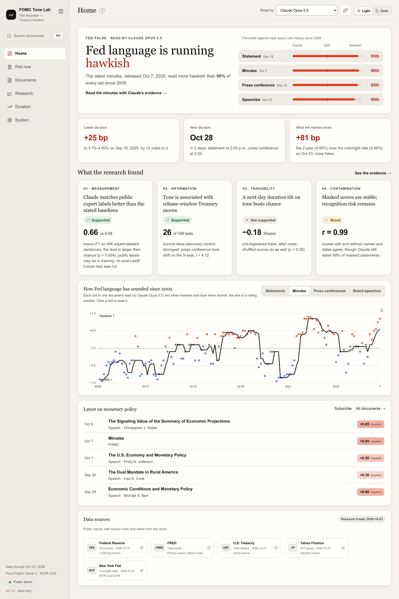

</div>

---

## Team

Final Project Group 2: **Genie Zhang, Hong-syuan Lin, Myron Pang, Weijun Situ**

New to the repository? [docs/HANDOFF.md](docs/HANDOFF.md) gets you running in five minutes; contributions are welcome ([CONTRIBUTING.md](CONTRIBUTING.md)).

## The question

Fed communication provides a reading of policy expectations. Eight times a year it publishes a decision at 2:00 p.m., the Chair takes questions at 2:30, the minutes follow three weeks later, and governors speak in between. **Hawkish** language points toward tighter policy and **dovish** language toward easier policy. This project tests their association with yield changes and the performance of a later duration trade. How much a bond portfolio gains or loses depends on its duration, ΔP/P ≈ −D × Δy: seven years of duration loses about 7% if yields rise one point.

So the topic asks: **can Claude read the Fed’s tone well enough, and early enough, to lean a bond portfolio’s duration before the market has priced it?** The brief warns that statements can reprice quickly and asks whether minutes, speeches or changes between consecutive statements leave an opportunity at a later trading horizon. [docs/ASSIGNMENT.md](docs/ASSIGNMENT.md) maps every line of the brief to the code, the page and the slide that answer it.

## The answers

**Duration workspace:** the separate Duration section connects a scored document to its earlier history,
fixed rule, entry date and historical test. Its scenario panel converts a user-selected
duration change into USD DV01, equal-dollar IEF/SHY legs, trading cost and parallel
yield-shock P&L. It uses fixed risk assumptions and does not generate a trading
recommendation or change the frozen results. [Scope, formulas and review](docs/DURATION_REVIEW.md).

Four hypotheses, written down before any result. Only the primary trading test was pre-registered; its code-correction rerun is disclosed in DESIGN.md. The other analyses are exploratory.

| | Hypothesis | Verdict | Evidence |
|---|---|---|---|
| **H1** | Claude labels tone closer to people than simpler methods | **Supported on public expert labels** | Macro-F1 **0.661** on 496 expert-labeled sentences, against 0.578 for a TF-IDF classifier, 0.576 for sentence embeddings and 0.511 for a dictionary; the lead over each is larger than chance (paired bootstrap, +0.08 over TF-IDF with a 95% interval of +0.03 to +0.14, p = 0.004). Asked again in a separate batch, Claude gives the same stance on 95% of 152 documents (r = 0.996) |
| **H2** | Tone is associated with Treasury yield changes over the release window | **Supported as association evidence** | **26 of 198** release-day tests survive Benjamini-Hochberg at q < 0.10, 16 of them on Claude’s reading. A one-standard-deviation hawkish change in press-conference tone is associated with a 3.9 bp 2-year yield increase over the release window (t = 3.90, q = 0.007; the day before, t = 1.71; with the 3-month bill as a surprise control, t = 3.20; with the TF-IDF classifier’s tone of the same transcripts as a control, t = 3.57, so the conditional association persists) |
| **H3** | A next-day duration tilt on Claude’s reading of minutes and speeches beats chance | **Not supported** | Sharpe **−0.18**, shuffled-score placebo p = 0.28, probabilistic Sharpe 22%; −10 bp a year on an aggregate-bond portfolio; none of 116 variants clears the Sharpe luck alone would produce (0.48). Re-run once after a code review; see [DESIGN.md](docs/DESIGN.md#8-what-we-found-21-october-2026) |
| **H4** | Scores do not come from remembering the documents | **Mixed** | Claude dates 99% of masked statements to the exact month, yet its scores barely move when dates, names and rates are masked (r = 0.99; same stance on 93%) |

The post-cutoff human test was not run. The 150 sampled sentences have Claude predictions, not human labels. The public expert labels used for H1 may be in the model's training data; masked and raw document scores agree (r = 0.99), which partly addresses the memorization concern but does not replace an independent human test.

On the public expert labels, Claude has higher agreement than the three stated baselines and shows its evidence (mean document evidence-match share: 99.96%). A RoBERTa-large fine-tuned on the same 1,984 hand-labeled sentences, added afterwards as a reference, has higher test macro-F1 (0.737 against 0.661; paired bootstrap p < 0.001). Claude received no task-specific fine-tuning by the team; possible prior exposure to the public labels remains a limitation. On whole documents the readers largely agree (r = 0.86 on minutes, 0.70 to 0.79 on the rest).

Claude's tone changes are associated with release-window yield changes, particularly at press conferences. The change from one statement to the next is associated with a 5-year move of +1.8 bp per standard deviation (t = 3.15), weaker at the 46 meetings without a press conference (t = 1.91). Daily windows cannot isolate these overlapping announcements or establish causality. The tested delayed duration tilt provides no reliable trading edge; that null does not establish that all information was fully priced by a particular close. Adding tone also produced no detected gain in the exploratory real-time forecast of the next decision (Research › Next decision).

## Present it

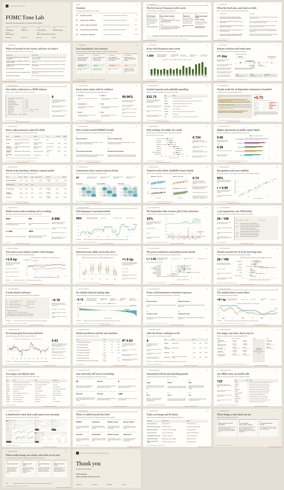

The project now has one 46-slide presentation integrating the introduction, methods, research results and technical implementation. Its numeric exhibits read the project store. The submission exports contain this same integrated deck. Check the hosted asset revision after publication to confirm which version is running.

- **The Story.** The deck has its own address, `/story`, apart from the dashboard (which has no Present button): open the [Story on the live demo](https://fedtone.web.app/story). `←` and `→` move, `F` goes full screen, `N` shows the speaker notes; every slide links to the page behind it.
- **PowerPoint.** [`FOMC-Tone-Lab.pptx`](docs/slides/FOMC-Tone-Lab.pptx) shows every slide exactly as on screen, with speaker notes; [`FOMC-Tone-Lab-editable.pptx`](docs/slides/FOMC-Tone-Lab-editable.pptx) rebuilds them from native text boxes with the charts as pictures, for restyling; [`outline.md`](docs/slides/outline.md) has every slide’s words and notes.
- **One integrated presentation.** Corpus and timing, the rubric and scoring engine, baseline and RoBERTa comparisons, measurement tests, event-study controls, trading rules, the forward test, and implementation are explained in the same deck. The default Story and submission exports require no second deck.
- **Presenter view.** Press `V` in the Story: a second window with the speaker notes, the next slide and a timer, kept on the same slide as the audience window.
- **Design and rebuild.** The reviewed deck uses a shared editorial grid, chapter markers, large exhibits and native editable tables and methods. [Presentation design](docs/PRESENTATION_DESIGN.md) documents the source and the bundled-runtime rebuild. `make slides` remains a standard content export; explicit technical/all options are legacy views, not additional submission requirements.

The contents page divides the presentation into five sections: question and data (slides 3 to 8), readers and validation (9 to 21), index, yields and duration (22 to 31), forward checks and implementation (32 to 41), and conclusions and limits (42 to 46). Slide 5 lists what we learned in the course and how we used it; slides 14 and 15 explain local RoBERTa training before the results are compared. [Course sources and training protocol](docs/COURSE_ALIGNMENT.md).

## Quickstart

Clone the public repository, `git clone https://github.com/flukier1016/fomc-tone-lab.git && cd fomc-tone-lab`, or
extract the submitted code ZIP, which holds the same files, into a new folder and start there.
Python 3.11 or newer is required (macOS ships 3.9, so install Python 3.12 or uv first).

```bash
make setup       # .venv and dependencies (Python 3.12; uses uv when available)
make demo-data   # the full store, every Claude score included: no key, no downloads
make serve       # dashboard at http://127.0.0.1:8000, the presentation at /story, API docs at /docs
```

To rebuild everything from the public sources instead, run `make run`: about 15 minutes the first time (mostly downloads), about a second when nothing has changed. Every Claude response is committed under `data/llm/`, so a rebuild reuses them and costs nothing. Without `make`: `pip install -r requirements.lock && pip install -e . --no-deps`, then `fomc run` and `fomc serve`. Or skip installing altogether: open the repository in **GitHub Codespaces** (Code, Codespaces, Create); the container runs `make setup` and `make demo-data` for you, then `make serve`.

## What is inside

| | |
|---|---|
| **1,509 Fed documents, minute-stamped** <br> 149 statements, 142 minutes, 95 press conferences (the Chair’s words only) and 1,123 Board speeches since 2009, 4.5 million words, each with the minute it became public, read from the document itself. | **Claude scoring with proof** <br> Claude Opus 5.5 reads every document against a versioned rubric (six policy dimensions, a stance from −1 to +1, confidence) and answers in structured JSON with verbatim evidence, located in the source as character spans and highlighted in the app. |
| **Three baselines on equal terms** <br> A policy-word dictionary, a TF-IDF classifier and sentence embeddings (all-MiniLM-L6-v2, run locally through ONNX), judged with Claude on the same human labels and run through the same event study and backtest. Claude’s lead is tested (paired bootstrap, McNemar) and its scores re-checked in a second batch. | **An event study a referee would accept** <br> Treasury yields from 3 months to 30 years (FRED, with the Treasury par curve as fallback) and the 2s10s slope over each release window; a day-before placebo, drift, a rate-surprise control, the decision as a control, statements with and without a press conference, Claude with the TF-IDF tone as a control, split samples, Benjamini-Hochberg q-values and response curves by tercile of tone. |
| **A pre-registered, deflated backtest** <br> Long IEF against short SHY, sized to ±1 year of duration around AGG (aggregate bonds) or IEI (Treasuries), entered after the news, with costs, Newey-West t, a shuffled-score placebo and probabilistic and deflated Sharpe ratios: 116 variants reported, one confirmatory. | **Memorization audit and labeling tool** <br> Masked identification and invariance checks (after the HW2 GameStop audit), plus a local tool for independent human labeling. The 150 post-cutoff sentences have Claude predictions; the human test was not run, so there is no team-majority result. |
| **Fed now: rates, the Committee, every decision** <br> Every decision parsed from the statement (21 hikes, 11 cuts, 111 holds), a word-level redline against the previous one; the target range, EFFR and SOFR, the latest vote, the 2-year’s lean and the whole Committee, all read from the Fed’s own documents. Click a member for their background in the Fed’s own words, every speech’s tone with the shifts a change-point test finds, their titles and their dissents. | **Dashboard, Story, REST API, CLI** <br> A Home page with the Fed pulse, the policy numbers and the four findings; six sections with their pages as tabs (a tab bar at the bottom on phones); Cmd+K search over 4.5 million words, shareable links to any view, the Story deck, JSON endpoints (the read-only ones revalidate with ETags), and one `fomc` command that runs the pipeline while preserving frozen research results. |

## How it works

The project answers the question in four steps. One command, `fomc run`, executes them in order over a single SQLite store and skips any step whose inputs have not changed. Since the freeze on 21 October 2026 it also leaves the event study, the backtest and the next-decision test as reported, whatever new data arrive (`--unfreeze` recomputes them); the forward test reads the new data instead.

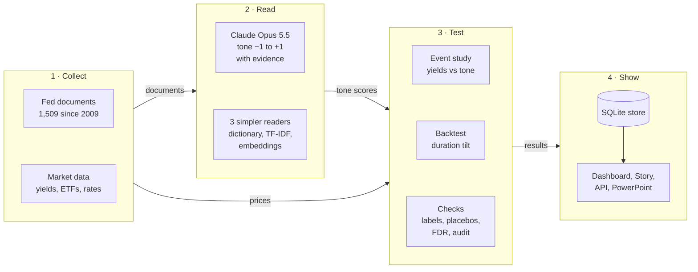

1. **Collect.** Download every statement, set of minutes, press-conference transcript and Board speech from the Fed’s website; keep only the Fed’s own words (the Chair’s answers rather than the reporters’ questions, minutes without the attendance list); record the minute each became public. Pull Treasury yields from FRED (or, when FRED is down, from the Treasury’s own par curve, which FRED republishes; the System › Data page shows which one the last run used), closes for five bond ETFs and the overnight rates for the same days. Then give every document its **release window**: from the last 3:30 p.m. Treasury fix before it became public to the first one after.
2. **Read.** Claude Opus 5.5 reads each document against a fixed rubric ([RUBRIC.md](docs/RUBRIC.md)): six policy dimensions, an overall stance and a score from −1 (dovish) to +1 (hawkish), with quotes as evidence. The code then finds every quote in the source and stores where it sits, so any score can be checked in seconds. For statements, Claude also compares each one with the previous statement. A word dictionary, a TF-IDF classifier and sentence embeddings score the same documents, so Claude has something to beat.
3. **Test.** The **event study** regresses each yield’s move over the release window on the tone, or on its change since the previous document: does a more hawkish document come with higher yields on the day? The **backtest** turns tone into a position: each score is compared with all earlier documents of the same type (a z-score); a hawkish reading shortens duration and a dovish one lengthens it, by up to one year on an aggregate-bond portfolio, entered only after the news is public, held five days, after costs. The **checks** keep both honest: agreement with human labels, a day-before placebo, shuffled scores, corrections for the number of tests run, and the memorization audit.
4. **Show.** Every result lands in one SQLite file. The dashboard, the Story deck, the REST API and the PowerPoint export all read that file, so they always agree.

### One document, end to end

The September 2026 decision, with the real numbers from the store:

| Step | What happened |
|---|---|
| **Published** | The FOMC statement of 16 September 2026, at 2:00 p.m. ET |
| **Claude reads it** | Score **+0.75**, hawkish, with evidence such as “The Committee decided to raise the target range for the federal funds rate by 1/4 percentage point to 3-3/4 to 4 percent”, located word for word in the statement |
| **Against July** | Claude’s score rose from +0.55 for the July statement. Asked to compare the two directly, Claude rates the change +2, the top of its −2 to +2 scale: a hold became a unanimous hike |
| **Release window** | From the 3:30 p.m. Treasury fix on 15 September to the one on 16 September, the 2-year rose 7 bp (4.67% to 4.74%) and the 5-year 3 bp |
| **Event study** | One of 141 decision-to-decision changes in the regression. Across all of them, a hawkish change of one standard deviation is associated with a 1.8 bp 5-year increase (t = 3.15); the window overlaps the press conference, limiting attribution to either announcement |
| **Minutes, three weeks later** | Released 7 October at 2:00 p.m. Claude scores them +0.85, 1.86 standard deviations above the 141 earlier sets of minutes |
| **The trade** | On its own, this signal shortens an AGG portfolio’s duration by 0.93 years (the z-score, capped at 2 and halved), entered at the 4:00 p.m. close on 8 October, the day after release, and held five trading days |
| **The result** | Yields fell that week (the 10-year from 5.22% to 5.10%), so the tilt cost about 16 bp: one illustrative loss, consistent with the absence of a reliable edge in the tested H3 duration tilt |

### The stages behind `fomc run`

| Stage | Command | What it does | Writes |
|---|---|---|---|
| Collect | `fomc collect` | Finds and cleans every Fed document, with its release minute | `documents`, full-text index, `committee`; raw pages cached by URL |
| Market | `fomc market` | Yields from FRED (the Treasury par curve it republishes when FRED is down), ETF closes, EFFR and SOFR | `yields`, `etf_prices`, `policy_rates` |
| Align | `fomc events` | Release windows and entry dates; each decision and its redline | `events`, `decisions` |
| Baselines | `fomc baselines` | Dictionary, TF-IDF and sentence-embedding scores; their accuracy on human labels, with the reference readers saved by `fomc finetune` and `fomc roberta` | `scores`, `validity`, `meta.readers` |
| Claude | `fomc llm-submit`, `llm-collect`, `llm-sync` | Message Batches to Claude; every response kept with its IDs, tokens and cost | `data/llm/` (committed), `llm_records`, `scores` |
| Audit | `fomc audit` | Masked dating and masked rescoring | audit results |
| Event study | `fomc evaluate` | 1,213 regressions; false-discovery q-values across the 198 in the main grid; response curves | `event_study`, `event_curves` |
| Backtest | `fomc backtest` | 116 variants, the pre-registered one flagged; placebo, PSR and DSR | `backtests`, `backtest_curves` |
| Next decision | `fomc forecast` | Exploratory: the market's lean and Claude's tone against each decision; real-time forecasts from 2017 | `meta.forecast` |
| Forward test | `fomc forward` | The frozen rules on data after 21 October 2026: the pre-registered trade, and each release's 2-year move against its type's rule | `meta.forward`, `data/forward/rules.json` |

The local Research › Team labels tool can save human annotations to `data/labels/<annotator>.csv`; the post-cutoff human test was not run. Claude predictions remain model labels. `fomc slides` turns the Story into PowerPoint.

## Claude, cost and keys

Every Claude call goes through one module, `src/fomc/llm/provider.py`. The research run as of 21 October 2026: **2,049 records** (1,509 documents, 142 decision-to-decision readings, 149 identification probes, 60 masked re-scorings, 152 test-retest re-scorings, 26 sentence batches, and 11 superseded readings kept for provenance) in seven Message Batches and five direct calls, no failed requests, **$32.44** in all (plus about $0.06 for a duplicate batch of the five re-readings, not used). Each record is keyed by a hash of prompt, schema and text and committed under `data/llm/`, so identical requests are cached and the whole team shares one set of results. Eight monthly anchor re-readings brought the operational total through 22 October to 2,057 records and $32.75; they do not change the frozen research results.

Scoring new documents needs your own key. It lives only in the git-ignored `.env` (mode 600), is never printed, logged or returned by the API, and the hosted demo never holds one. This repository contains no key or token: everything needed to explore the results is in the shipped snapshot, and `.env.example` shows the names only.

```bash
fomc key set                    # prompts for the key and checks it with a free call
fomc llm-estimate               # exact token counts and cost per model (free)
fomc llm-submit --what level    # only documents without a valid record, as one Message Batch (50% off)
fomc llm-collect --batch-id <id> --wait && fomc run
```

## Research design in one minute

- **Timing is the whole game.** A document can only explain prices fixed after it became public: a 2:00 p.m. statement gets a one-day window to the 3:30 p.m. Treasury fix, a press conference straddles the fix and gets two, and the pre-registered trade enters at the 4:00 p.m. close of the day after. Signals are standardized on earlier documents only. All of it is unit-tested.
- **The search is counted.** One confirmatory test was fixed in advance; every other specification is reported and charged for the search, with Benjamini-Hochberg q-values in the event study and deflated Sharpe ratios in the backtest.
- **Memorization is audited.** Claude has read history, including what markets did. Masked identification bounds how recognizable the documents are, score invariance offers partial reassurance rather than proof against memorization, and 34 documents released after the configured model cutoff provide a small additional check that grows with later meetings.
- **Limits, stated plainly.** Daily closes rather than ticks; a small post-cutoff sample; no post-cutoff human test; possible training exposure to the public expert labels; no user study of the dashboard yet ([the intended users, tasks and a study ready to run](docs/PRODUCT_VALIDATION.md)). Full design: [docs/DESIGN.md](docs/DESIGN.md).

## Data and efficiency

- **One portable store.** `data/fomc.db`: SQLite in WAL mode, schema v4 with automatic migrations, 20 tables plus the full-text index, about 30,000 rows, 51 MB.
- **Search without a second copy.** An external-content FTS5 index points at the document text instead of duplicating it (Porter stemming, ranked snippets).
- **Compact results.** Each backtest’s daily returns are one float32 blob aligned to the ETF calendar: 116 rows instead of about half a million.
- **Nothing is fetched or paid for twice.** 1,577 source files are cached by URL; Claude records are keyed by input hash; bulk scoring uses Message Batches at half price and a cached rubric prefix.
- **Open data only.** Every input is public, and every number traces back to a document, a price or a stored model response.

## Screens

Every page, captured whole in the light theme; click an image for full size. The dark theme is one key away (`t`).

| Fed now: rates, the latest vote, the Committee | Fed now › Decisions: every decision and its redline |
|---|---|
| 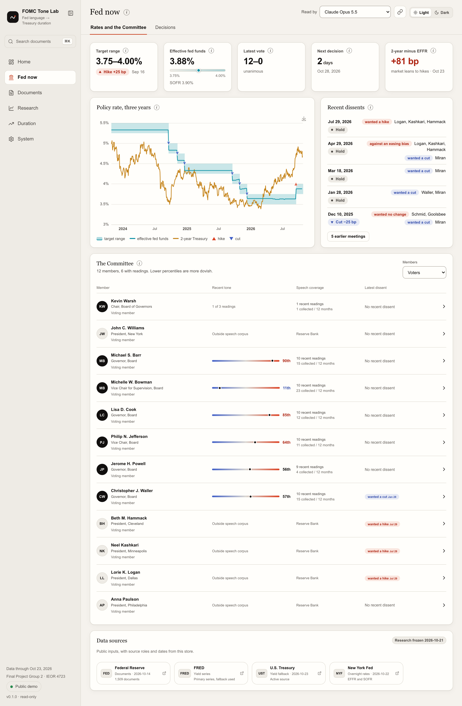 | 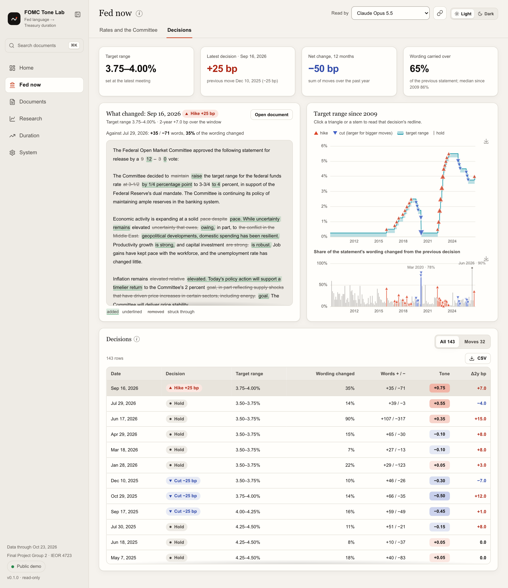 |
| **Research › Event study: the curve, controls, q-values** | **Research › Backtest: every variant, on AGG or IEI** |
| 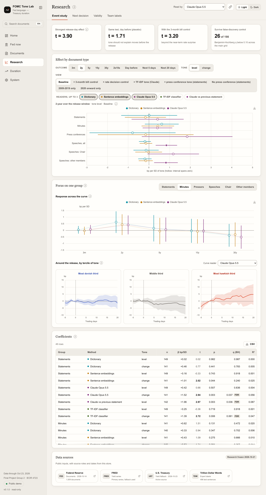 | 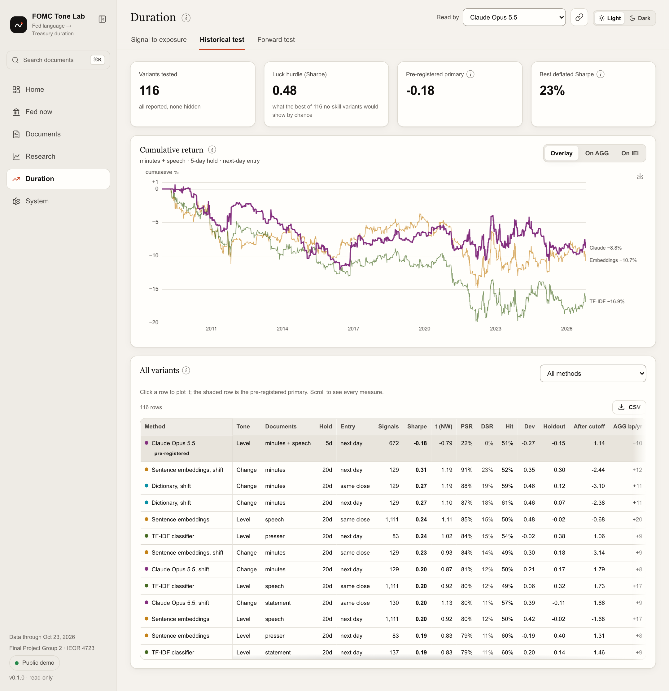 |
| **Research › Next decision: does tone add to what the market prices?** | **Research › Validity: Claude against three baselines** |
| 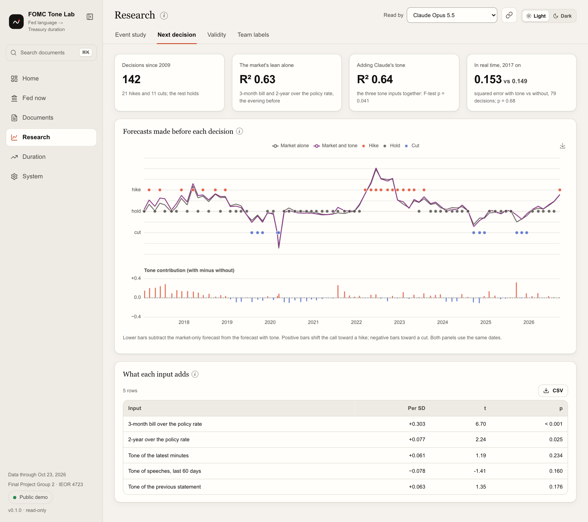 | 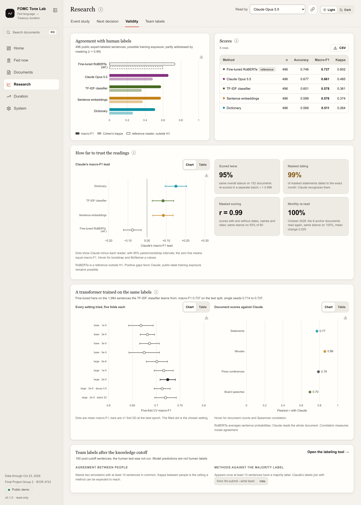 |

<details>
<summary><b>More pages:</b> search, team labels, scoring a text, the pipeline and the data</summary>

| Documents: full-text search | Research › Team labels: after the knowledge cutoff |
|---|---|
| 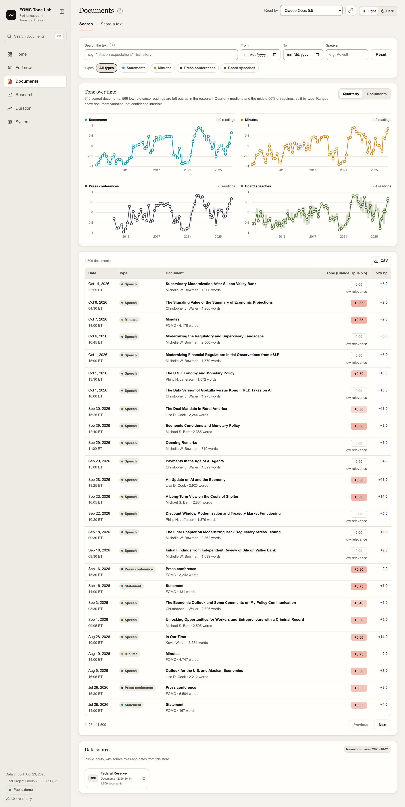 | 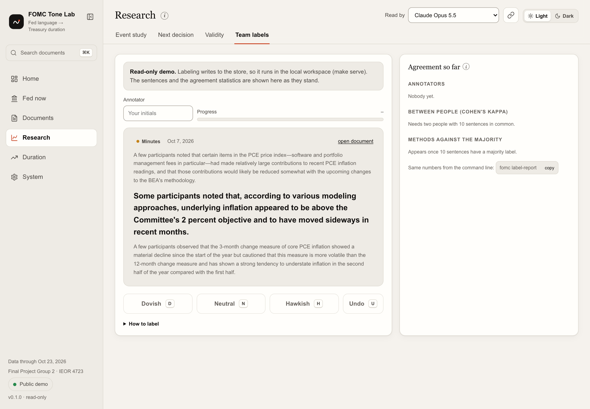 |
| **Documents › Score a text** | **System › Pipeline** |
| 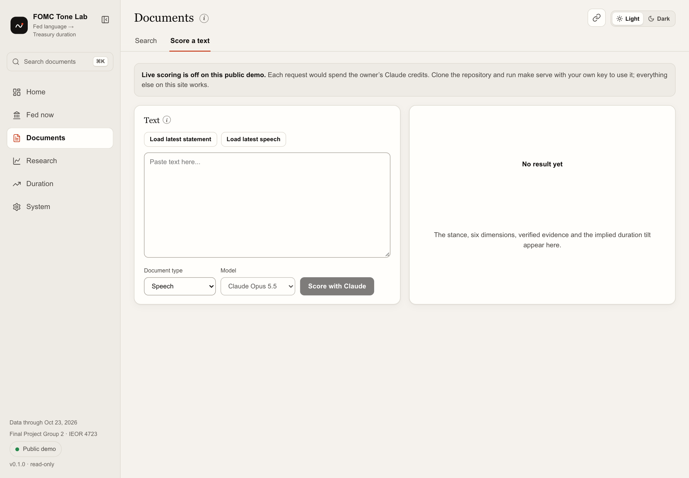 | 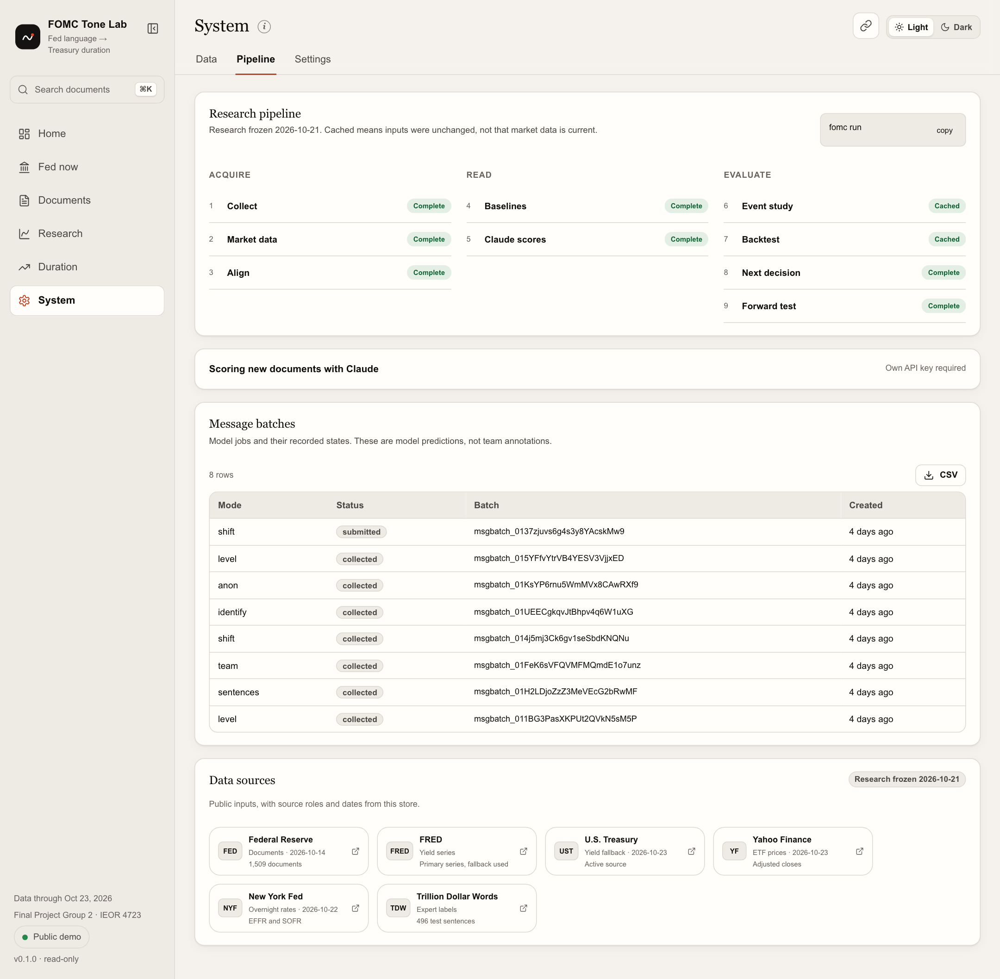 |
| **System › Data** | |
| 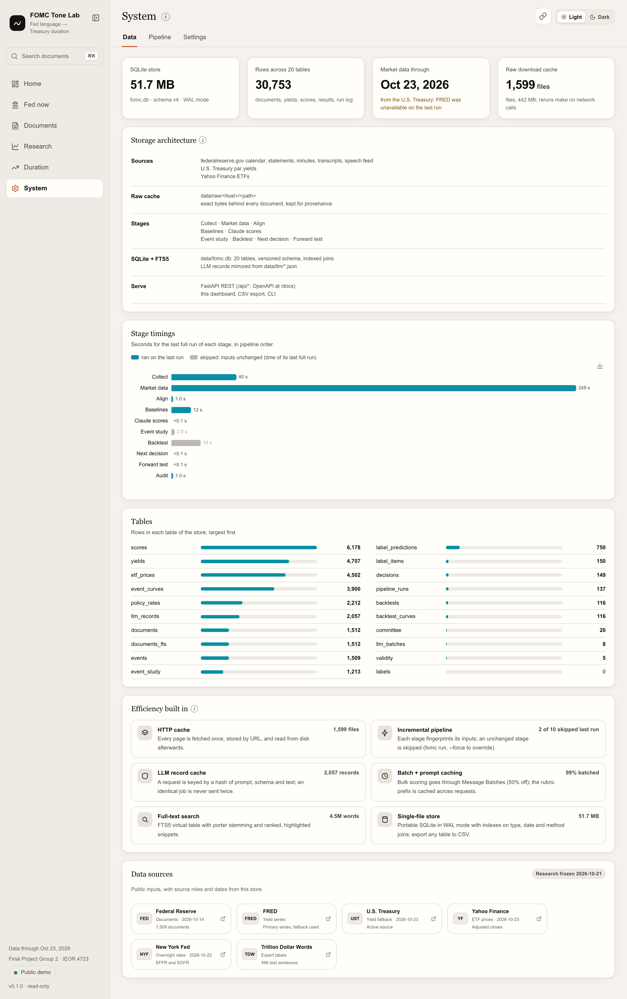 | |

</details>

## Repository layout

```text
src/fomc/
  collect.py  textclean.py  http.py      Fed documents: discovery, cleaning, cached downloads
  market.py   align.py                   FRED yields (Treasury fallback), ETFs, no-look-ahead event windows
  policy.py   fed.py                     decisions and redlines; policy rates, the Committee, dissents, biographies
  members.py                             a member over time: titles, dissents, shifts in the tone of their speeches
  dictionary.py  supervised.py  embeddings.py   the three baselines
  roberta.py  finetune.py                reference readers run offline: FOMC-RoBERTa (`fomc roberta`) and a RoBERTa
                                         fine-tuned here on the TF-IDF training data (`fomc finetune`)
  llm/  provider.py  rubric.py  scorer.py     Claude: credentials, versioned rubric, batches, verified records
  audit.py    labels.py                  memorization checks; team labels shared through git
  evaluate/   validity.py  event_study.py  backtest.py  forecast.py  forward.py
  story.py    slides.py                  the deck from the store; PowerPoint, outline, contact sheet
  findings.py                            the four hypotheses judged once, for the Home page and the deck
  db.py       store.py                   SQLite schema v4, migrations, persistence
  api.py      web/                       REST API and dashboard (no build step)
  cli.py                                 the `fomc` command
config/settings.yaml                     every tunable in one file
data/llm/  data/labels/                  Claude records; human annotation exports when present
data/baselines/                          the reference readers' labels, search and document scores (committed)
data/forward/  data/drift/               the forward test's frozen rules; the anchor documents re-read monthly
docs/                                    HANDOFF, ASSIGNMENT, DESIGN, WORKFLOW, RUBRIC, DATA, ARCHITECTURE, DEPLOY,
                                         OPERATIONS; slides/
tests/                                   72 offline tests
deploy/  .railway/                       hosted image, data snapshot, Cloud Build config; Railway infrastructure as code
scripts/                                 screenshots and the icon sprite
```

## Working together

- **Start here:** [docs/HANDOFF.md](docs/HANDOFF.md): status, setup, the demo script, a speaker split for the deck, and open work anyone can pick up.
- **Contributing:** [CONTRIBUTING.md](CONTRIBUTING.md): branches or direct commits, what CI checks, conventions, and where to add a baseline, a test or a slide.
- **Research rules:** no look-ahead bias (a document only explains prices fixed after it became public); the pre-registered test stays as written; a new model or prompt is a new experiment; provenance of Claude records and labels is never edited; keys never enter git.
- **Optional next check:** compare another provider's model on the 150 post-cutoff sentences using a team-owned key. This check was skipped for this delivery and would measure cross-model agreement, not human agreement; each provider's outputs must retain their own provenance.

## Deployment

The read-only demo, [fedtone.web.app](https://fedtone.web.app), runs on Google Cloud Run: `make deploy-cloudrun` builds `deploy/Dockerfile` with Cloud Build and rolls it out. The image ships a snapshot of the store with every Claude score and serves it with `FOMC_PUBLIC=1` (settings, live scoring and labeling locked; no key on the server; optional login with `FOMC_BASIC_AUTH`). The service scales to zero between visits, so it stays inside the free tier; a 1 USD monthly budget alerts on spend and, past it, switches billing off. A GitHub Actions workflow refreshes it every evening, and at 2:25 p.m. New York time on the afternoon of a statement or minutes: new Fed documents and market data, Claude scores for what is new (at most 5 USD a month), and a fresh deploy; the research results stay as reported, and a forward test runs their frozen rules on whatever is new. Subscribe to `/feed.xml` for each new document with Claude's reading. Running it day to day, costs and fixes: [docs/OPERATIONS.md](docs/OPERATIONS.md). A copy on Railway, rebuilt from `main` (infrastructure as code in `.railway/railway.py`), is kept as a backup. Refresh the hosted data with `make run && make deploy-snapshot`, then `make deploy-cloudrun` and a push. Details: [docs/DEPLOY.md](docs/DEPLOY.md).

Validity's statistical panels offer Chart / Table switches with per-panel memory, sorting and CSV downloads. Committee cards explain whether a missing tone percentile reflects too few eligible speeches or speech coverage.

## Engineering notes

- `make test` runs the offline suite: the look-ahead rules, the scoring engine against a stub client (no key, no cost), Benjamini-Hochberg against statsmodels, PSR and DSR, the paired tests and the stability check, migrations, the API in public mode, label sharing, the Story deck, the fine-tuned RoBERTa's bookkeeping (without PyTorch), the forward test's freeze, the release-day check, the monthly cap, the drift flag and the strict freshness check, and a guard that the hosted image imports nothing outside `requirements-serve.txt`. Tests never see a key, even on a machine that has one. `make lint` runs ruff.
- `make setup` installs the exact versions in `requirements.lock` (one file for macOS, Linux and Windows), the same set CI tests; `make lock` re-pins it after `requirements.txt` changes. `.devcontainer/` makes the repository open in Codespaces with nothing to install.
- A GitHub Actions workflow is set up to run lint, tests and a front-end check on every push and pull request; run `make test` and `make lint` locally for the same checks.
- The front end has no build step and uses open-source pieces: Lucide icons as an inline sprite, two system typefaces shared with the deck (Georgia for titles and headings, Arial for everything else), ECharts, WAI-ARIA dialog and focus patterns, GitHub-style keyboard shortcuts (`?` lists them), shareable view URLs, sortable tables with CSV export; the “Ink and Vermilion” palette keeps color for data (vermilion hawkish, indigo dovish), passes WCAG AA contrast and a color-blind separation check in both themes, and every page works at phone width. Details in [docs/ARCHITECTURE.md](docs/ARCHITECTURE.md#front-end).
- `fomc export` writes every table to CSV; `make snapshot` produces a compressed copy of the store; `docker build -t fomc-tone .` packages the CLI and dashboard.

## Data sources and licenses

[](https://www.federalreserve.gov/monetarypolicy/fomc.htm)
[](https://fred.stlouisfed.org/series/DGS10)
[](https://home.treasury.gov/resource-center/data-chart-center/interest-rates/TextView?type=daily_treasury_yield_curve)
[](https://finance.yahoo.com/quote/IEF/history/)
[](https://huggingface.co/datasets/gtfintechlab/fomc_communication)

The app's source badges show provider roles and actual stored dates. They distinguish the requested FRED series from an active Treasury fallback. See [the seven-part coverage audit](docs/BRIEF_AUDIT.md).


Federal Reserve Board statements, minutes, transcripts and speeches (U.S. government works, public domain); Treasury yields from FRED (St. Louis Fed) and the U.S. Treasury daily par yield curve; effective fed funds rate and SOFR from the New York Fed; SHY, IEI, IEF, TLT and AGG closes from Yahoo Finance via yfinance (research use); Trillion Dollar Words hand-labeled sentences (Shah, Paturi and Chava, ACL 2023, CC BY-NC 4.0, evaluation only); all-MiniLM-L6-v2 sentence embeddings (Apache-2.0) through fastembed; ECharts (Apache-2.0) and Lucide (ISC), vendored; the typefaces are the system's Georgia and Arial. Details in [docs/DATA.md](docs/DATA.md).

## License

The code and documentation are released under the [MIT License](LICENSE), copyright 2026 flukier1016. Data keep their
own terms, listed above: the Trillion Dollar Words labels are CC BY-NC 4.0 for non-commercial use, and the Yahoo
Finance prices are for research use. The Claude records in `data/llm/` are model outputs kept for provenance.

<sub>Columbia University IEOR 4723, AI-Augmented Investment Management, Fall 2026: Final Project Group 2 (Genie Zhang, Hong-syuan Lin, Myron Pang, Weijun Situ). Research code; nothing here is investment advice.</sub>
