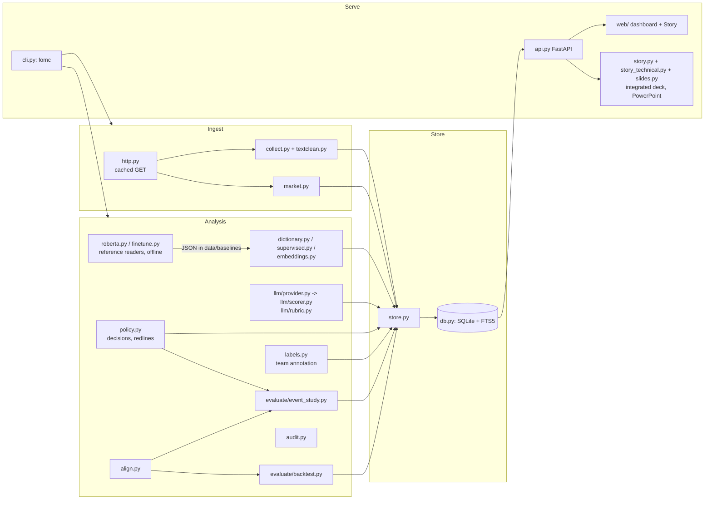

# Architecture

## Layers

Stages are plain functions that return DataFrames; `store.py` persists them; the CLI composes stages and records each run in `pipeline_runs`; the API only reads, except the Settings, live-scoring and labeling endpoints (all locked on a public deployment). The Story is one more reader: `story.py` assembles one integrated 46-slide presentation from the store, reusing method and implementation components in `story_technical.py`. `GET /api/story` defaults to this deck; the dashboard renders it, and `slides.py` exports the same content as PowerPoint and PDF with headless Chrome. Explicit technical/all CLI options are retained only as legacy exports for reproducibility. Each content slide takes the layout that shows its point best (`story.LAYOUTS`): the number beside the visual (standard), the visual first (mirror), two numbers set against each other (compare), the number and its facts in a band over a full-width chart (banner), or the visual alone (wide); the editable deck places its text boxes the same way.

## Store schema (v4)

| Table | Key | Content |
|---|---|---|
| `documents` | `doc_id` | metadata, release time and its source, clean text |
| `documents_fts` | rowid of `documents` | FTS5 external-content index over title, speaker and text (no duplicated text) |
| `yields`, `etf_prices` | `date` | Treasury yields (3m, 2y, 5y, 10y, 30y) from FRED, or the Treasury par curve when FRED is down; SHY, IEI, IEF, TLT and AGG closes |
| `events` | `doc_id` | event window, entry dates, 2y and 10y change over the window |
| `scores` | (`method`, `doc_id`) | one score per method per document; extra fields as JSON |
| `llm_records` | `path` | mirror of every Claude record: status, IDs, tokens, cost, evidence share, parsed output |
| `llm_batches` | `batch_id` | submitted batches and their state |
| `policy_rates` | `date` | effective fed funds rate and SOFR from the New York Fed |
| `committee` | `name` | the Committee as of the latest minutes: voter, alternate or non-voting; Board or Reserve Bank; role |
| `decisions` | `doc_id` | per statement: action, change in bp, target range, previous decision, share of wording kept, words added and removed |
| `validity` | `method` | agreement with the public human labels |
| `event_study` | (`doc_type`, `method`, `regressor`, `outcome`, `sample`, `control`) | coefficients, t, p, R-squared, and the Benjamini-Hochberg q-value on the main grid |
| `event_curves` | (`doc_type`, `method`, `regressor`, `bucket`, `day`) | average cumulative 2-year move around releases by tercile of tone |
| `backtests` | `run_id` | one row per variant (method, documents, level or shift signal, hold, entry), including PSR, DSR, the number of trials, the luck hurdle, and active return and tracking error on AGG |
| `backtest_curves` | `run_id` | daily returns as a float32 blob aligned to `etf_prices` |
| `label_items`, `labels`, `label_predictions` | `item_id` (+ annotator or method) | team annotation: sentences with context, each person's label (mirrored to `data/labels/<annotator>.csv` in git), each method's label |
| `pipeline_runs` | id | stage, status (ok, skipped, failed), timings, details |
| `meta` | key | schema version, stage fingerprints, the yield source, audit results, engineering facts for the deck |

Migrations run on connect. v1 to v2: the duplicated FTS text and the one-row-per-day backtest table are converted. v2 to v3: the derived `event_study` and `backtests` tables are rebuilt with their new columns, and the stages that fill them are marked stale so the next `fomc run` recomputes them. v3 to v4: `etf_prices` gains AGG and `backtests` gains the signal, active-return and tracking-error columns, again by marking the market, baseline, evaluation and backtest stages stale. Nothing collected or paid for is ever touched.

## REST API

Interactive documentation at `http://127.0.0.1:8000/docs`.

| Endpoint | Purpose |
|---|---|
| `GET /api/health` | document count and mode; the deployment health check |
| `GET /api/pulse` | the Fed pulse: latest reading per document type as a percentile of its history, next decision |
| `GET /api/overview` | counts, methods, latest yields, LLM status |
| `GET /api/methods` | scoring methods available, with coverage |
| `GET /api/documents` | filter by type, dates, speaker and text; default `mode=list` returns paginated snippets; `mode=scatter` returns every matching stored date, type and score for the timeline, with the same filters |
| `GET /api/documents/{id}` | text, every score, Claude reading with evidence, event window, and for statements the decision |
| `GET /api/documents/{id}/diff` | word-level redline of a statement against the previous decision |
| `GET /api/fed` | rates (range, EFFR, SOFR, 2y minus EFFR), the latest decision and vote, the Committee with dissents, speech tone and one line of each member's Fed biography |
| `GET /api/member?name=` | one member over time (`members.py`): the Fed's own biography sentences and their pages, every speech with its tone, the titles spoken under, dissents in the statement's words, stretches of steady tone, and what changed |
| `GET /api/tracker` | every decision with range, move, wording change, tone and the 2-year move; current state |
| `GET /api/index` | tone time series per document type, with rolling median |
| `GET /api/yields` | 3m, 2y, 10y history |
| `GET /api/event-study` | coefficients; filter by `outcome`, `sample`, `control` |
| `GET /api/event-curves` | response curves for one group, method and regressor |
| `GET /api/validity`, `/api/backtests`, `/api/backtests/curve?benchmark=AGG` | results; the curve can be shown as an overlay or on an AGG or IEI portfolio |
| `GET /api/duration`, `POST /api/duration/scenario` | risk assumptions and pure user-selected sizing/stress arithmetic; scenario POST makes no model call or store write and remains available in public mode |
| `GET /api/duration/context?doc_id=` | one stored document's primary-rule replay, using earlier eligible peers only, with its evidence link, delayed entry and explicit eligibility |
| `GET /api/sources` | source-provider badges with roles, store dates, official links and the active yield fallback |
| `GET /api/story` | the integrated main deck by default: every slide's title, number, takeaway, source, notes and chart data; legacy technical content is available only when explicitly requested |
| `GET /api/findings` | the four hypotheses judged from the store (`findings.py`): claim, verdict, one number; the Home page and the Story read the same verdicts |
| `GET /api/forecast` | exploratory: the market's lean and Claude's tone against each decision, with the real-time forecasts |
| `GET /api/reliability` | Claude against each baseline (paired bootstrap, McNemar), test-retest stability and the memorization audit |
| `GET /api/labels/summary`, `GET /api/labels/next`, `POST /api/labels`, `POST /api/labels/undo` | team annotation: progress, kappa, method agreement; the next sentence for an annotator; record or undo a label (403 on a public deployment) |
| `GET /api/pipeline`, `/api/system` | run log; storage, cache and timing figures |
| `GET/POST /api/settings`, `POST /api/settings/check` | key status (masked), save key, model and effort, free connectivity check |
| `POST /api/score` | score pasted text with Claude; returns evidence checks, cost and the implied duration tilt |

## Efficiency

| Mechanism | Effect |
|---|---|
| URL-keyed raw cache | a full re-collection reads 1,577 cached files in about 40 s with no network calls |
| Stage fingerprints | `fomc run` with nothing new takes about 1.4 s (all stages skipped) |
| Input-hash LLM records | an identical Claude job is never sent twice; reruns cost nothing |
| Message Batches + prompt caching | bulk scoring at 50% of list price; the rubric prefix is cached |
| External-content FTS5 | search index without a second copy of 30 MB of text |
| Blob curves | 116 rows instead of about half a million for daily backtest returns |
| WAL + checkpoint + vacuum | the store stays one compact file (51 MB with every Claude record mirrored) |
| Embedding cache by text hash | sentence embeddings are computed once per document and classifier version |
| Parallel headless Chrome | `fomc slides` exports the integrated 46-slide main presentation and its visuals in parallel; the actual count comes from the deck, not a hardcoded package manifest |

## Front end

The browser Story's scoped `.editorial` design shares content and layout dimensions with the reviewed PowerPoint workflow in [PRESENTATION_DESIGN.md](PRESENTATION_DESIGN.md). The local `render_presentation.py`, `export_presentation.mjs` and `finalize_presentation.mjs` tools prepare exhibits, author native editable elements and validate the exports with the bundled presentation runtime. They do not run in the hosted service or recompute research.

No build step: one ES module, vendored ECharts, and open-source assets checked into `src/fomc/web/vendor/` with their licenses.

| Practice | Source of the pattern | What it does here |
|---|---|---|
| Lucide icons as one inline SVG sprite | Lucide (ISC), `scripts/build_icons.py` | One consistent icon set; no icon requests; CI checks the sprite is up to date |
| Two system typefaces, Georgia for titles and headings and Arial for everything else, the same as the deck and write-up | System fonts on macOS and Windows; nothing downloaded | No font request at all; one face for what you read first, one for everything you scan, with lining tabular figures; the site, slides and write-up look alike |
| “Ink and Vermilion” tokens: ink-on-paper chrome, color only for data, light and dark each chosen | dataviz validator (OKLab ΔE under simulated color blindness, WCAG contrast) | Hawk and dove, the series and the document types stay distinct for color-blind readers; brand color never doubles as a signal |
| Stale-while-revalidate client cache, in-flight sharing, prefetch on hover | the SWR pattern | Page switches render from memory; hovering a nav item warms its data |
| ETag on the read-only endpoints (not health or the labeling queue, which change on every call), `Cache-Control: no-cache` | HTTP validation (RFC 9110) | Unchanged data costs a 304 with no body; the tag changes with the store, the date and a restart |
| View state in the URL (`#/event-study?out=d10y&reg=shift`) | shareable-URL convention | Any filtered view can be bookmarked or sent; a link button copies it |
| Six sections (Home, Fed now, Documents, Research, Duration, System), each section's pages as tabs; a tab bar at the bottom on phones; on a desktop the sidebar can be dragged wider or narrower and collapsed to an icon rail (`[`), remembered per browser; the deck lives apart at `/story` | grouped primary navigation and progressive disclosure | Fewer places to look; every earlier link (`#/tracker`, `#/label`) still opens its page |
| Keyboard map (`?`, `g` then a letter, `/`, `t`, `[`) | GitHub Primer keyboard shortcuts | Navigation without the mouse; a dialog lists every shortcut |
| Dialogs, focus trap, return focus, skip link, `aria-pressed`, `aria-sort`, charts as named images | WAI-ARIA Authoring Practices | Keyboard and screen-reader paths on every page; text and buttons at WCAG AA contrast (separate ink colors for text, brighter ones for chart fills) |
| Secondary text behind (i) tips | progressive disclosure | Cards show the number and one line; detail on hover or tap |
| Sortable tables and CSV download on every table; PNG export on every chart | data-table conventions | Results leave the dashboard in one click |
| `prefers-reduced-motion`, thin progress bar, skeletons only when loading takes over 120 ms | motion and loading guidelines | No flashing on cached pages; no animation for people who opt out |

## Security

- Keys come from the environment or `.env` (mode 600, git-ignored); only a masked hint is ever displayed or returned.
- The server binds to `127.0.0.1`; the Docker example publishes on localhost only.
- Search input is quoted before it reaches FTS5, so query syntax cannot break or alter a query; SQL uses parameters throughout.
- Model output is treated as data: parsed against a schema, range-checked, and its quotes verified.

## Testing

| Suite | Covers |
|---|---|
| `test_timing.py` | release-window rules, weekend and holiday handling, two-day press-conference windows, positions that earn only after entry, signals that use only earlier documents |
| `test_text_and_scoring.py` | statement cleaning, sentence splitting, dictionary signs, quote verification, schema closure, anonymization |
| `test_scorer_offline.py` | the scoring engine with a stub client: request shape (structured output, effort, fallback, cache control), records, caching, refusals, truncation |
| `test_store_api.py` | external-content FTS, blob round trip, migrations from v1, v2 and v3, API search and detail, the four findings from the store, the Home list of policy documents, hostile search syntax, tracker and redline endpoints, the Fed endpoint, ETag revalidation, the labeling flow with kappa, label files shared through git, public read-only mode, optional login, the AGG curve, the Story deck and its outline |
| `conftest.py` | every test runs with no key and a temporary label folder, so the suite never calls Claude or writes into the repository |
| `test_finetune.py` | the fine-tuned RoBERTa's bookkeeping without PyTorch: length-grouped batches that cover every sentence once, balanced class weights as in scikit-learn, the setting and epoch chosen on the folds alone, saved labels used only for the sentences they were made for |
| `test_forward.py` | the forward test: returns counted only after the freeze through the backtest's own code, each release scored against its frozen rule, rules and reader unmoved by a rerun of the event study or a new reader |
| `test_members.py` | a member over time: biography sentences quoted and dated from the Fed's pages (joining the Board kept apart from a later title, a middle initial not taken for a full stop, the Reserve Bank's page followed from "Read more"), a shift in tone found where it was planted and none in noise, the list of what changed (a dissent for no change read against the decision, a title the biography dates listed once), and the member endpoint |
| `test_ops.py` | running unattended: the release-day check on both clocks, the monthly cap counting only this month's direct calls and stopping the scheduled scoring, the drift flag on re-read anchors, the research stages frozen in `fomc run`, and the strict check that fails a run when statements, minutes, market data or Claude readings stop arriving |
| `test_research.py` | target ranges and moves from statement wording (fractions, non-breaking hyphens, directives), the decision chain, redlines, Benjamini-Hochberg against statsmodels, PSR and DSR, event panels with groups, controls, q-values and response curves, agreement metrics against scikit-learn, FRED parsing and its fallback, the embedding baseline with a stub encoder, evidence spans, shift signals and duration sizing, and a guard that the hosted API (Story included) imports nothing outside `requirements-serve.txt` |
| `test_duration.py` | money/DV01/overlay identities, shock direction, budget caps, zero trades, invalid configuration and non-finite requests, empty research, public non-writing calculation, live-score history minimums and explicit duration years, prior-only document replay against the canonical backtest signal, source-fallback provenance |
