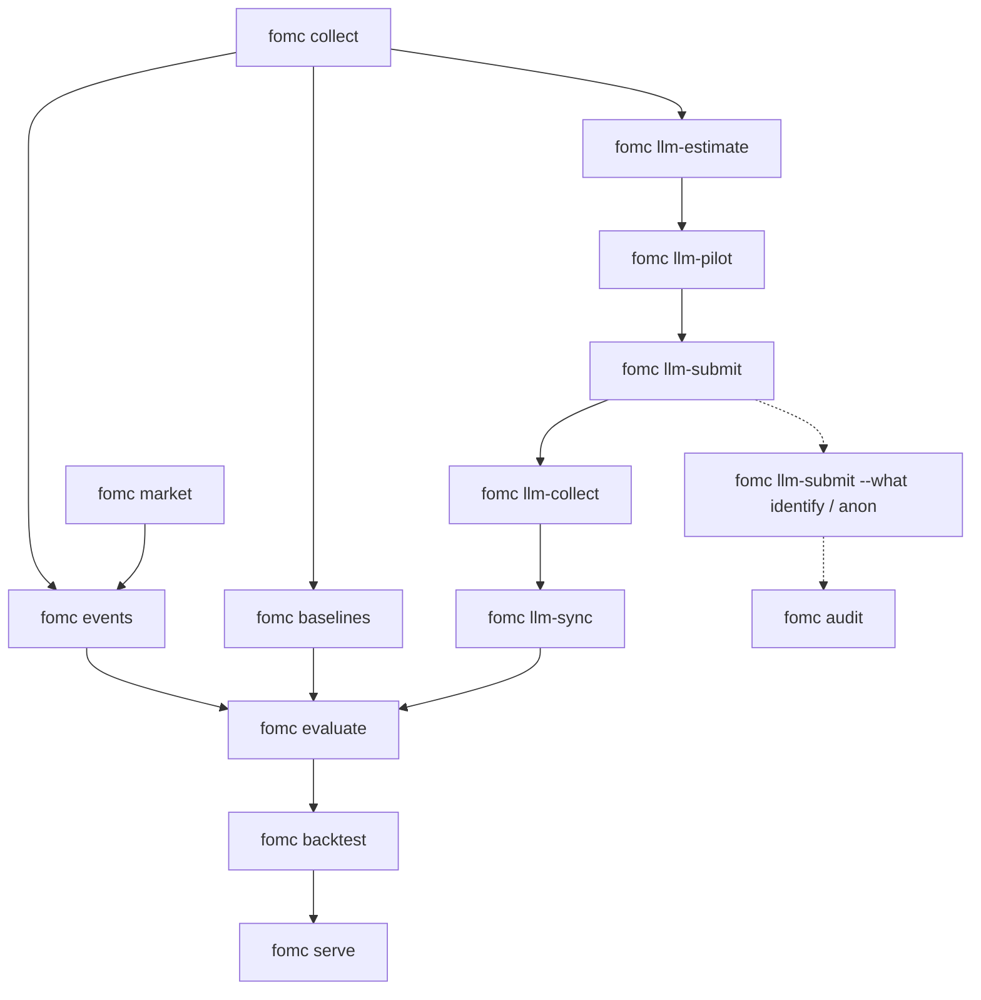

# Workflow

How the pipeline runs, how Claude scoring is done safely, and how the four of us share the work. For setup and the current status, start with [HANDOFF.md](HANDOFF.md).

## 1. Pipeline at a glance

`fomc run` runs the stages in order (collect, market, events, baselines, llm-sync, audit, evaluate, backtest); none of them calls Claude, so it is free. Each stage fingerprints its inputs and is skipped when they are unchanged; `--force` reruns everything, `--start` and `--until` run a slice.

| Stage | Quality check before moving on |
|---|---|
| collect | `fomc status`: counts per type and year look complete (8 meetings a year, minutes for each); `time_source` mostly `document_text` or `speech_json`; no `404` notes |
| market | Yields and ETFs end on the last trading day; no gaps on FOMC days |
| events | Press conferences have two-day windows; statements one-day; speeches after 3:30 p.m. move to the next day; every scheduled statement has a decision (Fed now › Decisions shows the target-range path) |
| baselines | `validity` table populated for the dictionary, TF-IDF and sentence embeddings; both learned baselines beat the dictionary |
| evaluate | Day-before placebo near zero for the headline result; the effect survives the 3-month bill control and keeps its sign in both samples; report its q-value, not only its t |
| backtest | Primary row present once Claude scores exist; placebo run with `--placebo` before reporting; quote PSR for the primary and DSR for anything exploratory |

## 2. Claude scoring protocol

**Status, 21 October 2026:** steps 1 to 9 are done for rubric v1 on Claude Opus 5.5 (2,049 records, seven batches and five direct calls, $32.44; the stability run in step 8 used one repeat, `r2`, on 152 documents), and Claude has labeled the team sentences in step 10. Open: our own labels in step 10 ([HANDOFF.md](HANDOFF.md#5-open-work-anyone-can-pick-up)).

1. **Key.** Each member uses their own key (`fomc key set` or the Settings page). Never commit `.env`; never paste keys into chat or issues.
2. **Estimate (free).** `fomc llm-estimate` counts tokens exactly with the free endpoint and prints the batch cost for Opus 5.5, Sonnet 5.5 and Haiku 5.5. Agree the model and budget as a team.
3. **Pilot.** `fomc llm-pilot --n 8` scores eight documents spread across types and years. Open each in the dashboard: is the stance sensible, are the quotes real (the verification share should be close to 1), is `policy_relevance` right for supervision speeches?
4. **Freeze the rubric.** If the pilot leads to prompt changes, edit `src/fomc/llm/rubric.py`, bump `RUBRIC_VERSION`, pilot again. Once frozen, do not touch it for the main run.
5. **Batch.** `fomc llm-submit --what level` submits every document as one Message Batch (50% off). Note the batch id.
6. **Collect.** `fomc llm-collect --batch-id <id> --wait` writes one record per document, re-runs any refusal synchronously with server-side fallback, then syncs scores into the store.
7. **Shift scores.** `fomc llm-submit --what shift --types statement` (and minutes if budget allows); collect it with the same flags, `fomc llm-collect --what shift --types statement --batch-id <id> --wait`. Statements are paired decision with decision; notices are left out.
8. **Stability.** `fomc llm-submit --what level --limit 150 --run-tag r2` and again with `r3`; compare overall stance agreement.
9. **Audit.** `fomc llm-submit --what identify --types statement minutes` and `--what anon --types statement minutes --limit 60`, then `fomc audit`.
10. **Human check.** `fomc label-sample --n 150` draws sentences from documents released after June 2026. Two or more members label all of them independently on Research › Team labels (keys D, N, H; U to undo; each person types their initials). Every label is written to `data/labels/<initials>.csv`; commit that file, and everyone’s next `make serve` or `fomc run` loads it. `fomc llm-submit --what team` asks Claude for the same sentences; `fomc label-report` and the Validity page then show kappa between people and each method's agreement with the majority label.
11. **Re-evaluate.** `fomc run` picks up the new scores, refreshes the event study and backtest, and the dashboard shows the pre-registered result.

Records are never overwritten: a different model, rubric version or run tag writes to its own folder under `data/llm/`. Commit `data/llm/` so the team shares one set of paid results.

## 3. Team and workstreams

Final Project Group 2: Genie Zhang, Hong-syuan Lin, Myron Pang, Weijun Situ. The areas below are a map of the code, not an assignment: anyone can pick up anything, and it helps to say in the group chat (or open a draft pull request) before starting something large.

| Area | Covers | Main files |
|---|---|---|
| Data and alignment | Collection quality, release times, market data, event windows | `collect.py`, `textclean.py`, `market.py`, `align.py` |
| Claude scoring and audit | Rubric, batches, stability, contamination audit, cost | `llm/`, `audit.py` |
| Baselines and validity | Dictionary, TF-IDF, sentence embeddings, human labels, validity tables | `dictionary.py`, `supervised.py`, `embeddings.py`, `labels.py`, `evaluate/validity.py` |
| Market tests | Event study, backtest | `evaluate/event_study.py`, `evaluate/backtest.py` |
| Story and product | Dashboard, Story deck, PowerPoint, live demo | `web/`, `api.py`, `story.py`, `slides.py`, `deploy/` |

Everyone labels the 150 post-cutoff sentences, independently and before looking at anyone else’s file.

## 4. Timeline

| Milestone | State |
|---|---|
| Setup and data: 1,509 documents, yields, ETFs, event windows | done |
| Pilot and rubric freeze (rubric v1) | done |
| Full scoring: levels, statement shifts, test sentences | done |
| Audit: masked identification and invariance | done |
| Market tests: event study with false-discovery control, pre-registered backtest with placebo | done |
| Story: 30-slide deck, PowerPoint, live demo | done |
| Team labels on the 150 post-cutoff sentences | open |
| Stability run (`--run-tag r2`, 152 documents) | done |
| Rehearsal: four speakers, one part each (HANDOFF.md has a split) | open |
| After the 28 October decision: collect, score, rerun, refresh the deck and the demo | open |

## 5. Definition of done

- One command rebuilds every number in the deck: `fomc run` reuses the committed Claude records, then `make slides`.
- Every reported number appears in the store and the dashboard.
- The primary test is reported with its placebo, whatever it shows; all variants are listed.
- Contamination audit and post-cutoff results are in the write-up.
- `make test` and `make lint` pass; CI is green.

## 6. Git workflow

The full guide is [CONTRIBUTING.md](../CONTRIBUTING.md). In short:

- Pull requests and direct commits are both welcome. Short branches (`labels-gz`, `slide-titles`) and a pull request suit anything that changes results; small, safe changes can go straight to `main`. CI runs lint and the offline tests on every push.
- Commit code, configs, docs, `data/llm/` (paid Claude records), `data/labels/` (team labels) and, when refreshing the demo, `deploy/fomc.db.gz`. Do not commit `.env`, `config/local.yaml`, `data/raw/` or `data/fomc.db`; `make demo-data` or `make run` recreates the store.
- Keep notebooks out of `src/`; anything reusable becomes a function with a test.
